<p align="center">
  
</p>

<p align="center">
  <a href="https://github.com/ishandutta2007/Awesome-Awesome-Awesome"></a><a href="https://discord.gg/jc4xtF58Ve"></a> <a href="https://github.com/ishandutta2007/Awesome-Web-Content-Authoring/stargazers"></a> <a href="https://github.com/ishandutta2007/Awesome-Web-Content-Authoring/network/members"></a> <a href="https://github.com/ishandutta2007/Awesome-Web-Content-Authoring/blob/main/LICENSE"></a> <a href="https://github.com/ishandutta2007/Awesome-Web-Content-Authoring/pulls"></a> <a href="https://github.com/ishandutta2007"></a>
</p>

# 🌐 Awesome Web Content Authoring

> **A curated catalog of state-of-the-art SaaS platforms, open-source headless CMS engines, Git-backed Markdown authoring workflows, and visual page builders.**

**Web content authoring** bridges the gap between editorial creativity and modern software engineering. It empowers non-technical editors, marketers, and copywriters with intuitive visual interfaces, structured forms, and asset workflows—while providing developers with clean REST, GraphQL, and Local APIs, version-controlled schemas, and database ownership.

Whether you require an **instant SQL admin panel**, a **TypeScript-native CMS embedded in Next.js React Server Components**, a **Git-backed Markdown engine for Jamstack static sites**, or an **enterprise multi-locale composable content cloud**, this index covers the entire authoring spectrum.

---

## 📑 Table of Contents

- [📊 Sector Overview & Market Dynamics](#-sector-overview--market-dynamics)
- [☁️ Top SaaS & Hosted Platforms](#️-top-saas--hosted-platforms)
- [💻 Open-Source GitHub Projects](#-open-source-github-projects)
  - [Open-Source Project Details](#open-source-project-details)
  - [Open-Source Comparison Matrix](#open-source-comparison-matrix)
- [🧭 Decision Matrix: Choosing Your Content Stack](#-decision-matrix-choosing-your-content-stack)
- [⭐ Star History](#-star-history)
- [💖 Support & Sponsorship](#-support--sponsorship)
- [🤝 How to Contribute](#-how-to-contribute)
- [⚖️ Disclaimer & Licensing Notes](#️-disclaimer--licensing-notes)

---

## 📊 Sector Overview & Market Dynamics

The global **Web Content Management (WCM) and Digital Experience Platform (DXP)** market is estimated at **$14.5 Billion to $16.5 Billion in 2025–2026**, expanding at a solid **~14% CAGR**, with the specialized **Headless & Composable Content Management software** subsector accelerating beyond **$2.0 Billion to $3.9 Billion** at an **18%–21% CAGR**.

### 🔍 Market Fragmentation vs. Concentration

- **Moderately Fragmented Overall:** The broader enterprise market remains moderately fragmented. Established legacy DXP monoliths (Adobe Experience Manager, Microsoft, Oracle) retain entrenched enterprise suites, while agile cloud-native platforms and composable microservices rapidly capture mid-market and cloud-forward enterprises.
- **Dynamic Composable Layer (Non-Winner-Take-All):** The modern headless and visual content authoring tier exhibits high fragmentation rather than a winner-take-all monopoly. Teams actively divide between:
  1. *Managed enterprise SaaS clouds* (Contentful, Sanity, Storyblok) for governance, live collaboration, and SLA-backed infrastructure.
  2. *Developer-owned open-source engines* (Strapi, Payload, Directus, Ghost) driven by strict data sovereignty, custom database hosting, and code-defined schemas.
  3. *Git-based flat-file engines* (TinaCMS, Decap CMS, Sveltia CMS, Keystatic) for Jamstack developers seeking zero-database maintenance and Git commit auditability.

---

## ☁️ Top SaaS & Hosted Platforms

The following table summarizes the market leaders in hosted and SaaS web content authoring. Platforms are sorted **descending by Company Size (Valuation / Annual Recurring Revenue)**.

| 🏢 Platform | 📈 Company Size (Valuation / Revenue) | 💳 Starting Paid Tier | 🎁 Free Tier Limit | 🎯 Key Focus & Editorial Workflow |
| :--- | :--- | :--- | :--- | :--- |
| [**Contentful**](https://www.contentful.com/) | **$1.25B Valuation** / **~$219M ARR** *(Acquired by Salesforce for $1.25B; $3.0B peak Series F)* | **$300 / month** *(Lite Plan)* | **Free Forever:** Up to 10 users, 1 starter space, 2 environments, 2 locales, 25 content types, 10,000 records, 50 GB asset bandwidth/mo, and 100k API calls/mo. | **Enterprise Headless Standard:** Omnichannel API-first structured content governance, multi-locale workflows, enterprise RBAC, and SLA guarantees. |
| [**Sanity**](https://www.sanity.io/) | **~$500M+ est. Valuation** / **~$40M+ ARR** *($136M+ funding; $85M Series C in 2025)* | **$15 / seat / month** *(Growth Plan)* | **Free Forever:** Up to 20 user seats (Admin & Viewer), 2 public datasets, 10,000 documents, 100 GB asset storage, 100 GB bandwidth/mo, 250k API requests/mo, 1M API CDN requests/mo. | **Design-First Collaborative Studio:** Real-time multi-user editing, GROQ and GraphQL queries, customizable React-based Studio, and flexible schema modeling. |
| [**Storyblok**](https://www.storyblok.com/) | **~$350M+ est. Valuation** / **~$30M–$40M ARR** *($138M funding; $80M Series C in 2024)* | **$99 / month** *(Growth Plan; $90/mo billed annually)* | **Free Forever:** 1 user seat (up to 2), 1 space, 20,000 stories/space, 200 components, 2 locales, 25k AI credits, 100 GB bandwidth/mo, 100k API calls/mo. | **Visual Component Page Builder:** Live interactive visual preview editor allowing non-technical editors to assemble responsive pages block-by-block. |
| [**Builder.io**](https://www.builder.io/) | **~$250M est. Valuation** / **~$15M–$20M ARR** *(Series A & B backed by Greylock)* | **$24 / user / month** *(Pro Plan; $29/mo billed monthly)* | **Free Forever:** Up to 5 users, 1 design system, 75 monthly Agent Credits, daily rate caps (~15 AI gen/day), and public builder.cloud publishing. | **Visual Headless IDE & CMS:** Drag-and-drop page creation syncing directly with production React, Next.js, Vue, and Svelte component design systems. |
| [**Prismic**](https://prismic.io/) | **~$80M Valuation** / **~$15M ARR** *($20M Series A via Eurazeo & Aglaé)* | **$10 / month** *(Starter Plan; billed annually or $15/mo monthly)* | **Free Forever:** 1 user seat, unlimited documents, 2 locales, 100 GB CDN bandwidth/mo, and 4M API calls/mo. | **Slice Machine Component CMS:** Reusable content components ("Slices") tightly coupled with Next.js, Nuxt, and SvelteKit development. |
| [**Hygraph**](https://hygraph.com/) *(formerly GraphCMS)* | **~$75M est. Valuation** / **~$10M ARR** *($43.7M funding; $30M Series B)* | **$199 / month** *(Growth Plan)* | **Free Forever:** Up to 3 user seats, 2 roles, 1,000 content entries, 2 locales, 100 GB monthly asset traffic, and 1M API operations/mo (capped at 5 req/s). | **Federated GraphQL Hub:** Content federation uniting multiple remote APIs, legacy databases, and microservices into a unified authoring schema. |

---

## 💻 Open-Source GitHub Projects

Explore the leading self-hosted, database-backed, and Git-backed open-source content authoring solutions. Sorted **descending by GitHub star count**.

### Open-Source Project Details

1. ### [**Strapi**](https://github.com/strapi/strapi) [](https://github.com/strapi/strapi/stargazers)
   - **Architecture:** Node.js TypeScript/JavaScript Headless CMS.
   - **Database Support:** PostgreSQL, MySQL, MariaDB, SQLite.
   - **License:** MIT License (Community Edition).
   - **Key Highlights:** The most widely adopted open-source headless CMS in the ecosystem. Offers a graphical Content-Type Builder, fine-grained Role-Based Access Control (RBAC), an expansive plugin marketplace with 100+ extensions, and dual REST & GraphQL APIs. Best suited for greenfield projects seeking community maturity.

2. ### [**Ghost**](https://github.com/TryGhost/Ghost) [](https://github.com/TryGhost/Ghost/stargazers)
   - **Architecture:** Node.js Web Publishing & Content Management System.
   - **Database Support:** MySQL 8, SQLite3.
   - **License:** AGPL-3.0 License.
   - **Key Highlights:** Leading open-source publishing platform built specifically for professional content creators, journalists, newsletters, and publication media. Features a distraction-free Koenig card-based rich-text editor, native email newsletters, member subscriptions, and clean REST APIs.

3. ### [**Payload**](https://github.com/payloadcms/payload) [](https://github.com/payloadcms/payload/stargazers)
   - **Architecture:** TypeScript-Native Full-Stack CMS embedded in Next.js.
   - **Database Support:** PostgreSQL & SQLite (via Drizzle ORM), MongoDB (via Mongoose).
   - **License:** MIT License.
   - **Key Highlights:** Code-as-configuration architecture where schemas are defined in type-safe TypeScript files. Drops directly into the Next.js `/app` router, offering zero-network-hop Local API queries inside React Server Components alongside REST and GraphQL endpoints.

4. ### [**Directus**](https://github.com/directus/directus) [](https://github.com/directus/directus/stargazers)
   - **Architecture:** Database-First Admin Panel and Data Platform.
   - **Database Support:** Connects directly to existing PostgreSQL, MySQL, MariaDB, SQLite, CockroachDB, and MS SQL Server.
   - **License:** Business Source License (BSL 1.1 / Source-Available; free for teams <$5M revenue).
   - **Key Highlights:** Wraps your existing database without enforcing proprietary migrations or data locks. Delivers an immediate polished admin panel, field-level permissions, WebSocket subscriptions, REST/GraphQL APIs, and a native Model Context Protocol (MCP) server for AI agent integrations.

5. ### [**Wagtail**](https://github.com/wagtail/wagtail) [](https://github.com/wagtail/wagtail/stargazers)
   - **Architecture:** Python & Django Enterprise Content Management System.
   - **Database Support:** PostgreSQL, MySQL, SQLite, Oracle (via Django ORM).
   - **License:** BSD-3-Clause License.
   - **Key Highlights:** Enterprise-grade CMS renowned for its intuitive StreamField block-based editor, robust editorial governance, multi-site handling, accessibility compliance, and headless REST/GraphQL integration. Trusted by NASA, Google, and the UK NHS.

6. ### [**Decap CMS**](https://github.com/decaporg/decap-cms) *(formerly Netlify CMS)* [](https://github.com/decaporg/decap-cms/stargazers)
   - **Architecture:** Single-page React application for Git-based workflows.
   - **Storage Backend:** Git repository (GitHub, GitLab, Bitbucket, Gitea).
   - **License:** MIT License.
   - **Key Highlights:** The foundational Git-backed headless CMS. Delivers a clean editorial UI that commits Markdown, JSON, YAML, or TOML files directly to your Git repository, triggering automated CI/CD static site builds across Astro, Hugo, Jekyll, or Gatsby.

7. ### [**Grav CMS**](https://github.com/getgrav/grav) [](https://github.com/getgrav/grav/stargazers)
   - **Architecture:** Fast, Lightweight Flat-File CMS in PHP.
   - **Storage Backend:** Flat files on disk (Markdown and YAML frontmatter, no SQL database required).
   - **License:** MIT License.
   - **Key Highlights:** Ultra-fast flat-file web authoring platform powered by Twig templating and sophisticated file-system caching. Features an optional graphical admin plugin, comprehensive CLI tools, and over 100 plug-and-play themes and extensions.

8. ### [**TinaCMS**](https://github.com/tinacms/tinacms) [](https://github.com/tinacms/tinacms/stargazers)
   - **Architecture:** Git-backed Markdown CMS with Real-Time Contextual Editing.
   - **Storage Backend:** GitHub repository (Markdown, MDX, JSON, YAML) + GraphQL indexing.
   - **License:** Apache-2.0 License.
   - **Key Highlights:** Delivers contextual live-preview editing for Jamstack frameworks (Next.js, Astro, Hugo, Eleventy). Editors click directly on page components to modify copy and media, while Tina automatically pushes Git commits behind the scenes.

9. ### [**Sveltia CMS**](https://github.com/sveltia/sveltia-cms) [](https://github.com/sveltia/sveltia-cms/stargazers)
   - **Architecture:** Lightweight Svelte-based SPA successor to Netlify/Decap CMS.
   - **Storage Backend:** Git repository (GitHub, GitLab, Gitea).
   - **License:** MIT License.
   - **Key Highlights:** Modern drop-in replacement for Netlify/Decap CMS written in Svelte. Served entirely as a single static HTML file from a CDN. Resolves hundreds of legacy Netlify CMS bugs, accelerates authoring performance, and provides first-class internationalization (i18n).

10. ### [**Squidex**](https://github.com/Squidex/squidex) [](https://github.com/Squidex/squidex/stargazers)
    - **Architecture:** Event-Sourced Headless CMS built on .NET Core & C#.
    - **Database Support:** MongoDB.
    - **License:** MIT License.
    - **Key Highlights:** Engineered with an Event Sourcing (CQRS) architecture for auditability and compliance. Supplies automatic versioning, multi-lingual asset pipelines, GraphQL and REST endpoints, scriptable content validation, and enterprise .NET ecosystem integration.

11. ### [**Keystatic**](https://github.com/Thinkmill/keystatic) [](https://github.com/Thinkmill/keystatic/stargazers)
    - **Architecture:** TypeScript-first Content Management Engine for Local & Git-backed workflows.
    - **Storage Backend:** Local file system during dev, GitHub in production (Markdown, MDX, JSON, YAML).
    - **License:** MIT License.
    - **Key Highlights:** Created by Thinkmill for Next.js, Astro, and Remix. Allows developers to write content schemas in pure TypeScript with custom rich-text components, providing live editing locally or saving directly to GitHub branches with PR-based review flows.

12. ### [**Kirby CMS**](https://github.com/getkirby/kirby) [](https://github.com/getkirby/kirby/stargazers)
    - **Architecture:** File-Based CMS with Vue.js-powered Panel in PHP.
    - **Storage Backend:** Files and folders on disk (Markdown, TXT, YAML).
    - **License:** Proprietary source-available commercial license (free for local development).
    - **Key Highlights:** Beloved by creative agencies and designers for its minimalist architecture, customizable Vue-based Panel, zero-SQL setup, and headless REST/KQL (Kirby Query Language) API capabilities.

13. ### [**FireCMS**](https://github.com/firecmsco/firecms) [](https://github.com/firecmsco/firecms/stargazers)
    - **Architecture:** React & TypeScript Admin Panel and Content Manager for Firebase/Firestore.
    - **Database Support:** Google Cloud Firestore / Firebase.
    - **License:** MIT License (Core) / Commercial Pro modules.
    - **Key Highlights:** Instantly builds a spreadsheet-style, editable admin dashboard directly over Firestore collections with real-time syncing, custom React form fields, role security rules, and file upload pipelines.

14. ### [**dotCMS**](https://github.com/dotCMS/core) [](https://github.com/dotCMS/core/stargazers)
    - **Architecture:** Enterprise Hybrid/Headless Java Content Management System.
    - **Database Support:** PostgreSQL, MySQL, Oracle, MS SQL Server.
    - **License:** Apache-2.0 License (Core Community Edition).
    - **Key Highlights:** Hybrid authoring engine combining API-first headless distribution with traditional visual template rendering. Features multi-tenant site networks, workflow approval trees, and enterprise Java backend scalability.

---

### Open-Source Comparison Matrix

| 📦 Engine | ⭐ Stars | ⚙️ Language / Framework | 🗄️ Storage / Database | 📄 License | 💡 Best For |
| :--- | :--- | :--- | :--- | :--- | :--- |
| **[Strapi](https://github.com/strapi/strapi)** | [](https://github.com/strapi/strapi/stargazers) | Node.js / TypeScript | PostgreSQL, MySQL, MariaDB, SQLite | MIT | Greenfield headless apps with rich plugin requirements |
| **[Ghost](https://github.com/TryGhost/Ghost)** | [](https://github.com/TryGhost/Ghost/stargazers) | Node.js / JavaScript | MySQL 8, SQLite | AGPL-3.0 | Blogs, newsletters, membership sites, publishing media |
| **[Payload](https://github.com/payloadcms/payload)** | [](https://github.com/payloadcms/payload/stargazers) | TypeScript / Next.js | PostgreSQL, SQLite, MongoDB | MIT | Next.js full-stack apps desiring type safety & Local API |
| **[Directus](https://github.com/directus/directus)** | [](https://github.com/directus/directus/stargazers) | Node.js / TypeScript | PostgreSQL, MySQL, SQLite, MS SQL | BSL 1.1 | Instant admin UI over existing SQL databases |
| **[Wagtail](https://github.com/wagtail/wagtail)** | [](https://github.com/wagtail/wagtail/stargazers) | Python / Django | PostgreSQL, MySQL, SQLite | BSD-3-Clause | Enterprise Django teams & accessibility-focused sites |
| **[Decap CMS](https://github.com/decaporg/decap-cms)** | [](https://github.com/decaporg/decap-cms/stargazers) | React / JavaScript | Git (GitHub, GitLab, Bitbucket) | MIT | Static Jamstack blogs needing Git-backed authoring |
| **[Grav](https://github.com/getgrav/grav)** | [](https://github.com/getgrav/grav/stargazers) | PHP / Twig | Flat-file Markdown (Disk) | MIT | Zero-database self-hosted sites & lightweight setups |
| **[TinaCMS](https://github.com/tinacms/tinacms)** | [](https://github.com/tinacms/tinacms/stargazers) | React / TypeScript | Git Repo + GraphQL index | Apache-2.0 | Contextual visual editing for Astro, Next.js & Hugo |
| **[Sveltia CMS](https://github.com/sveltia/sveltia-cms)** | [](https://github.com/sveltia/sveltia-cms/stargazers) | Svelte / TypeScript | Git (GitHub, GitLab, Gitea) | MIT | Ultra-fast CDN-hosted successor to Netlify CMS |
| **[Squidex](https://github.com/Squidex/squidex)** | [](https://github.com/Squidex/squidex/stargazers) | .NET Core / C# | MongoDB | MIT | High-compliance event-sourced enterprise setups |
| **[Keystatic](https://github.com/Thinkmill/keystatic)** | [](https://github.com/Thinkmill/keystatic/stargazers) | TypeScript / React | Local FS & GitHub Git | MIT | Next.js and Astro sites with TypeScript schemas |
| **[Kirby](https://github.com/getkirby/kirby)** | [](https://github.com/getkirby/kirby/stargazers) | PHP / Vue.js | Flat-file (Disk) | Commercial | Design studios wanting a polished file-based admin |
| **[FireCMS](https://github.com/firecmsco/firecms)** | [](https://github.com/firecmsco/firecms/stargazers) | React / TypeScript | Google Cloud Firestore | MIT / Commercial | Rapid admin panels over Firestore databases |
| **[dotCMS](https://github.com/dotCMS/core)** | [](https://github.com/dotCMS/core/stargazers) | Java | PostgreSQL, MySQL, Oracle | Apache-2.0 | High-volume multi-site enterprise Java ecosystems |

---

## 🧭 Decision Matrix: Choosing Your Content Stack

```
                              ┌──────────────────────────────────┐
                              │  What is your Primary Storage?   │
                              └─────────────────┬────────────────┘
                                                │
                 ┌──────────────────────────────┼──────────────────────────────┐
                 │                              │                              │
                 ▼                              ▼                              ▼
     ┌───────────────────────┐      ┌───────────────────────┐      ┌───────────────────────┐
     │   Managed SaaS Cloud  │      │  Self-Hosted Database │      │  Git / Flat-File Disk │
     └───────────┬───────────┘      └───────────┬───────────┘      └───────────┬───────────┘
                 │                              │                              │
        ┌────────┴────────┐            ┌────────┴────────┐            ┌────────┴────────┐
        ▼                 ▼            ▼                 ▼            ▼                 ▼
  [Contentful]       [Storyblok]   [Directus]        [Payload]    [TinaCMS / Keystatic] [Grav / Decap]
  Enterprise DXP    Visual Builder Existing DB     Next.js Native  Live Git Preview     Zero DB / Static
```

- **Choose Managed SaaS (Contentful, Sanity, Storyblok, Builder.io, Prismic)** if you have zero DevOps bandwidth, require zero infrastructure maintenance, need multi-region CDN distribution out-of-the-box, or have non-technical marketing teams demanding real-time visual drag-and-drop authoring.
- **Choose Database-First (Directus, Strapi, Payload, Wagtail)** if data sovereignty is paramount, you already possess a PostgreSQL/MySQL database, your developers demand full code-review control over migrations, or compliance mandates on-premises deployment.
- **Choose Git-Backed (TinaCMS, Keystatic, Decap CMS, Sveltia CMS)** if you are building Jamstack sites (Next.js, Astro, Hugo, Eleventy), where all editorial changes should pass through Git commits, pull requests, and automated deployment pipelines without running a persistent database.

---

## ⭐ Star History

[](https://star-history.dera.page/#ishandutta2007/Awesome-Web-Content-Authoring&type=date&legend=top-left)

---

## 💖 Support & Sponsorship

Thank you for visiting and supporting the **Awesome Web Content Authoring** initiative! Maintaining and continually updating this curated directory takes time, research, and dedication.

If you found this resource helpful for choosing your content management stack, exploring modern headless CMS options, or discovering Git-backed open-source engines, please consider supporting the project:

- ⭐ **Star the Repository:** Help other developers and digital creators discover this list.
- 🍴 **Fork & Contribute:** Keep the catalog accurate, up-to-date, and comprehensive.
- 📢 **Share with Peers:** Spread the word across your engineering teams, digital agencies, and tech communities.
- ☕ **Buy Me a Coffee / Sponsor:** You can directly sponsor ongoing research and project maintenance via the [GitHub Sponsors Dashboard](https://github.com/sponsors/ishandutta2007).

<p align="left">
  <a href="https://github.com/sponsors/ishandutta2007">
    
  </a>
</p>

---

## 🤝 How to Contribute

We welcome community contributions, corrections, and new entries!

1. **Fork the repository** to your personal GitHub account.
2. **Add or modify entries** in `README.md` adhering to the existing formatting and categorization standards.
3. Ensure all links point to authoritative documentation, and include clear details on pricing, database support, and open-source licenses.
4. **Submit a Pull Request (PR)** with a concise summary of changes.

---

## ⚖️ Disclaimer & Licensing Notes

- This repository is a **community-curated index** compiled for informational purposes. Inclusion does not imply endorsement.
- **Licensing Considerations:** Pay close attention to licensing before deploying:
  - **Directus** uses the Business Source License (BSL 1.1), which is source-available and free for organizations under $5M annual revenue, but requires a commercial license beyond that threshold.
  - **Payload, Strapi (Community), Decap, Keystatic, Grav, and FireCMS (Core)** are licensed under OSI-approved permissive licenses (MIT or Apache-2.0).
  - **Ghost** is licensed under AGPL-3.0, which imposes copyleft network requirements when modifying and hosting the platform.
  - **Kirby** requires a paid commercial license for production use.
- All trademarks and brand names belong to their respective copyright holders.
